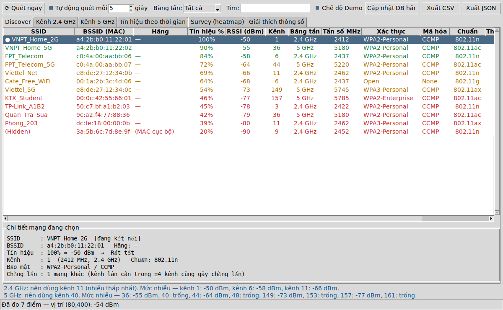
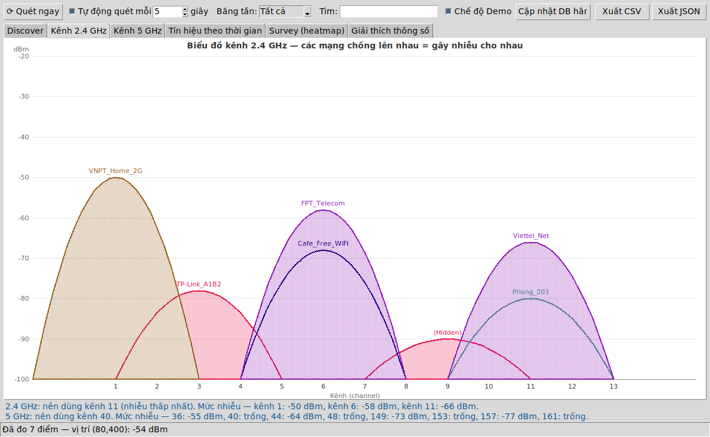
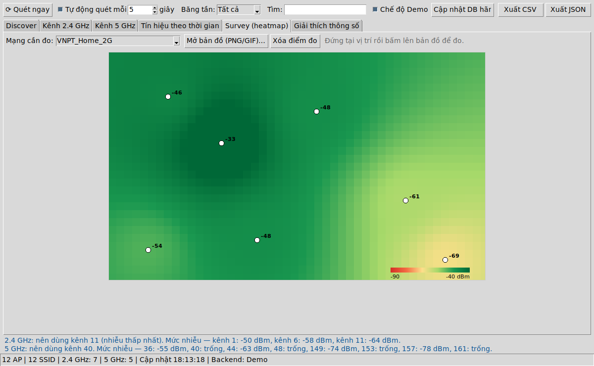

# WiFi Scanner — mini NetSpot

Tool quét các mạng WiFi lân cận kèm thông số chi tiết, viết bằng Python thuần (chỉ dùng thư viện chuẩn, **không cần `pip install`**).
Tool chỉ yêu cầu card WiFi quét mạng xung quanh (giống khi bấm biểu tượng WiFi trên thanh taskbar) rồi hiển thị kết quả; không kết nối, không bẻ khóa và không bắt gói dữ liệu của mạng nào.

## Chạy

```bash
python app.py          # quét WiFi thật (Windows: netsh, Linux: nmcli)
python app.py --demo   # dữ liệu giả lập, dùng khi máy không có card WiFi
python app.py --cli    # in bảng ra terminal 1 lần, không mở GUI
```

Yêu cầu: Python 3.9+ có tkinter (Windows cài Python từ python.org là có sẵn; Ubuntu: `sudo apt install python3-tk network-manager`).

**Windows:** bật *Settings → Privacy & security → Location* (Windows 11 không cho `netsh` liệt kê WiFi nếu tắt Location) và bật WiFi.

## Ảnh chụp (dữ liệu Demo)





## Chức năng (so với NetSpot)

| NetSpot | Tool này |
|---|---|
| Discover mode: bảng SSID/BSSID/signal/channel/band/security | Tab **Discover**: SSID, BSSID, hãng, %, dBm, kênh, băng tần, tần số, xác thực, mã hóa, chuẩn 802.11, thấy lần đầu/cuối, sắp xếp theo cột, lọc băng tần, tìm kiếm |
| Channel graph 2.4/5 GHz | Tab **Kênh 2.4 GHz / 5 GHz** + gợi ý kênh ít nhiễu nhất |
| Signal level theo thời gian | Tab **Tín hiệu theo thời gian** (Ctrl+click nhiều dòng để so sánh) |
| Survey + heatmap | Tab **Survey**: mở bản đồ PNG/GIF, bấm vào từng vị trí để đo, nội suy IDW thành heatmap |
| Export | Xuất CSV / JSON |
| — | Tab **Giải thích thông số** (tiện cho phần thuyết minh video) |

## Cấu trúc code

| File | Vai trò |
|---|---|
| `scanner.py` | Backend: gọi `netsh`/`nmcli`, parse kết quả → `AccessPoint`; chế độ demo |
| `analysis.py` | dBm ↔ %, đánh giá chất lượng, tính nhiễu kênh & gợi ý, tra hãng (OUI), thang màu |
| `charts.py` | Vẽ biểu đồ kênh, biểu đồ thời gian, heatmap trên `tkinter.Canvas` |
| `app.py` | Giao diện tkinter, vòng quét nền (thread), xuất file, CLI |

## Cách tính

- **dBm = % / 2 − 100** (công thức Windows/NetworkManager dùng để đổi chất lượng tín hiệu ↔ RSSI).
- **Tần số:** 2.4 GHz = 2407 + 5×kênh; 5 GHz = 5000 + 5×kênh.
- **Nhiễu 2.4 GHz:** kênh cách nhau < 5 số thì chồng lấn; hệ số chồng lấn giảm tuyến tính (cùng kênh 1.0 → cách 4 kênh 0.2). Cộng công suất (mW) của các AP, đổi lại dBm, chọn trong {1, 6, 11} kênh có nhiễu thấp nhất.
- **Heatmap:** nội suy IDW — giá trị tại ô = Σ(wᵢ·dBmᵢ)/Σwᵢ với wᵢ = 1/(khoảng cách² + 1).

## Hãng sản xuất (cột "Hãng")

Bấm **Cập nhật DB hãng** để tải `oui.txt` từ IEEE (hoặc tải tay từ https://standards-oui.ieee.org/oui/oui.txt rồi để cạnh `app.py`). MAC có bit "locally administered" (SSID ảo/guest, MAC ngẫu nhiên) hiện `(MAC cục bộ)` vì không có trong OUI.

## Giới hạn

- Không đọc được độ rộng kênh (20/40/80 MHz) và noise floor/SNR: `netsh`/`nmcli` không cung cấp. NetSpot đọc trực tiếp từ driver nên có.
- Kênh 6 GHz (WiFi 6E) hiện trong bảng nhưng chưa có biểu đồ riêng.
- macOS chưa hỗ trợ quét thật (dùng `--demo`).
- Survey đo bằng cách bấm tay trên bản đồ (không tự dò vị trí).

## Đẩy lên GitHub

```bash
git init
git add .
git commit -m "WiFi scanner - mini NetSpot"
git branch -M main
git remote add origin https://github.com/<user>/<repo>.git
git push -u origin main
```
